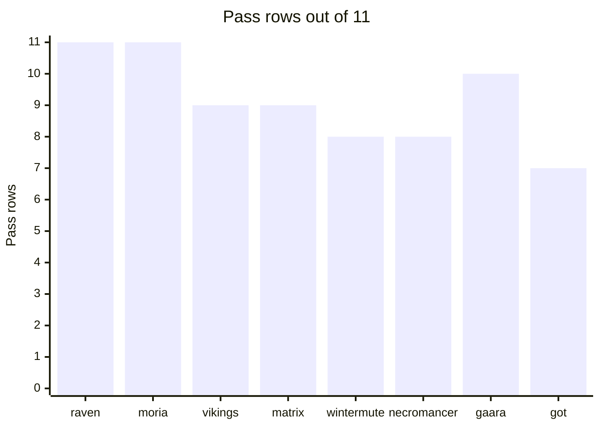
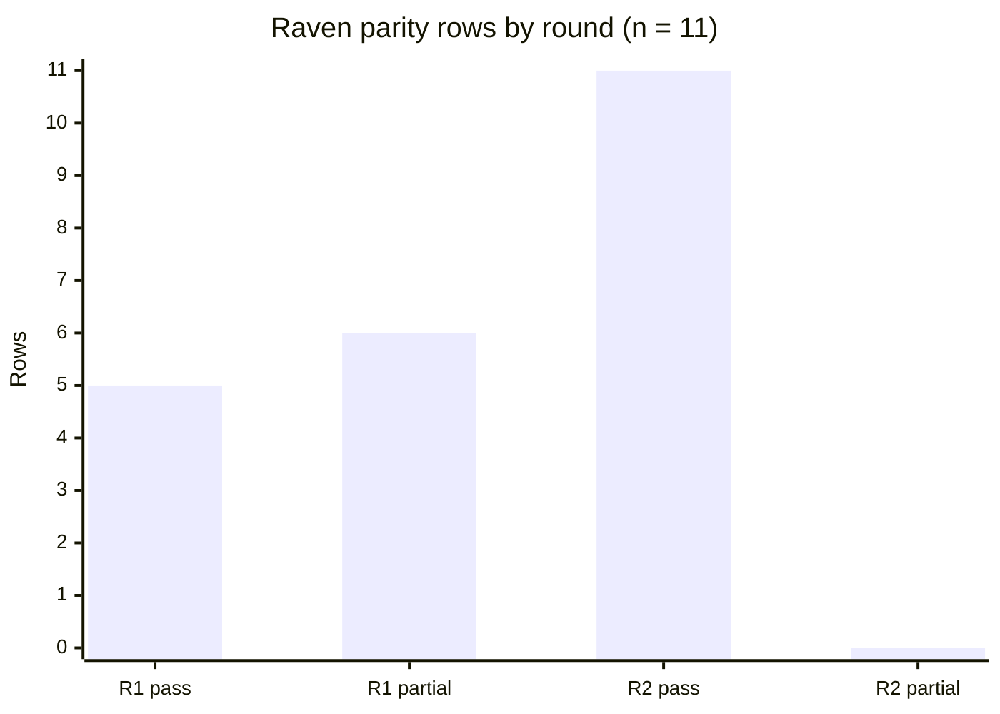
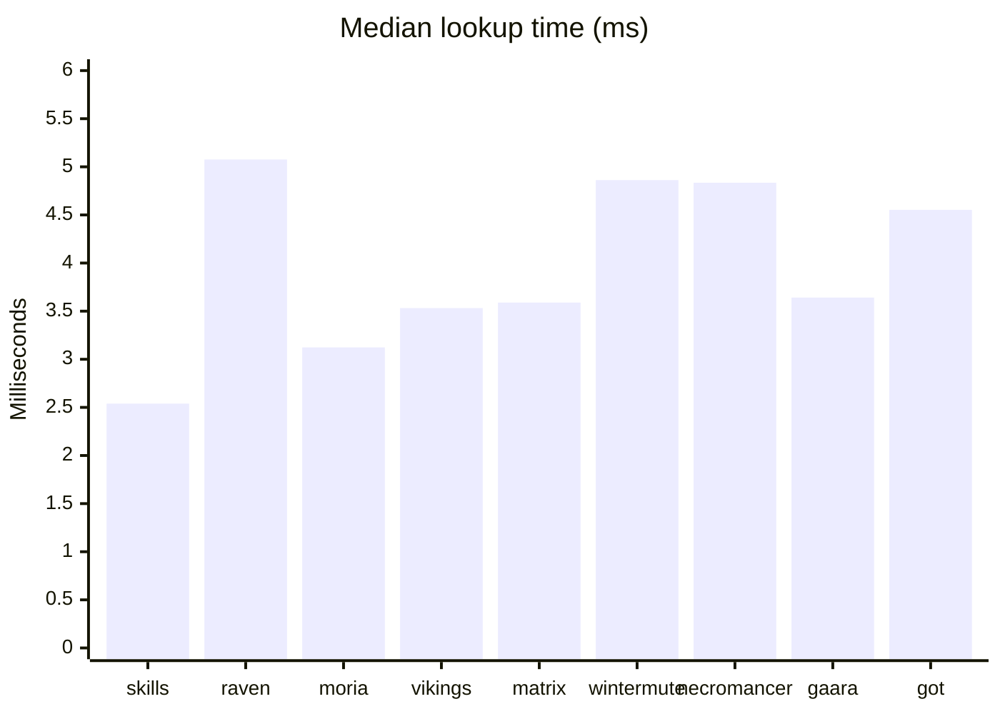

# ZeroCrowd-Labs

ZeroCrowd-Labs is a set of Docker Compose replicas of owned VulnHub virtual machines. Each replica keeps the guest's listeners, accounts, and service layout, and it runs under a memory cap at or below the virtual machine's RAM. The point is efficiency: one appliance no longer needs a full guest kernel and a multi-gigabyte hypervisor seat to expose the same ports.

The folder holds eight finished labs, the six skills used to build them, a seventh skill that designs a new scenario from those labs, and the parity and lookup records. Disk images and appliance archives stay in the original working directories. Password files and shadow extracts were not copied.

`mrrobot-lab` is the one appliance in the set that was not converted. The host antivirus blocked the file before import, so that folder has no Compose project and it is not in the scores below.

> **Correction (14 October 2026).** That sentence is stale. The MrRobot
> appliance was subsequently converted: `labs/mrrobot-lab/` now contains
> a Compose project and a built-and-running replica scored **8 pass /
> 3 partial / 0 missing** in its `replica-parity.md`. The headline
> scores below remain the eight-lab set (73/15/0 of 88; 5,248 MB of caps
> against 8,168 MB). Including MrRobot, the scored corpus is nine labs:
> **81 pass / 18 partial / 0 missing of 99 rows**, with configured caps
> totalling 5,632 MB against 8,680 MB of guest RAM. See
> `paper/VALIDATION.md` for the audit.

## Why replace the virtual machine

A VulnHub appliance is a complete guest: its own kernel, a large disk, and a reserved RAM size. A container shares the host kernel and starts from a pinned userspace. That is the efficiency gain, and it is also the limit. The replica can match packages, ports, users, and cron. It cannot match the guest kernel. Every lab records that as an explicit gap.

Configured memory caps for the eight finished replicas sum to **5248 MB**, against **8168 MB** of guest RAM. Raven's cap equals its 512 MB guest. The other replicas are capped below the guest allocation. These figures are Compose limits, not measured resident memory.

| Lab | Guest RAM | Replica cap | Published address |
| --- | ---: | ---: | --- |
| raven-lab | 512 MB | 512 MB | `10.88.10.10` ports 80, 22 |
| moria-lab | 1024 MB | 512 MB | `127.0.0.1` ports 80, 22, 21 |
| vikings-lab | 1024 MB | 512 MB | `10.88.10.11` ports 80, 22 |
| matrix-lab | 512 MB | 384 MB | `10.88.10.12` ports 80, 22, 31337 |
| wintermute-lab (two guests) | 2048 MB | 1024 MB | `10.88.10.13` and `10.88.10.14` |
| necromancer-lab | 512 MB | 384 MB | `10.88.10.15` port 22 |
| gaara-lab | 1024 MB | 512 MB | `10.88.10.16` ports 22, 80 |
| got-lab | 1512 MB | 1408 MB | `10.88.10.17` |
| **Total** | **8168 MB** | **5248 MB** | |

```mermaid
xychart-beta
    title "Configured memory (MB)"
    x-axis ["raven", "moria", "vikings", "matrix", "wintermute", "necromancer", "gaara", "got"]
    y-axis "MB" 0 --> 2100
    bar [512, 1024, 1024, 512, 2048, 512, 1024, 1512]
    bar [512, 512, 512, 384, 1024, 384, 512, 1408]
```



*Figure 1. Guest RAM (first series) and replica memory cap (second series). Wintermute is two guests, 1024 MB each, and two containers, 512 MB each.*

## Benefits

- **Less reserved RAM.** The eight caps are 2920 MB under the sum of the guest allocations, about 36% lower, while guest port numbers stay the same.
- **The same checklist on every appliance.** Eleven rows decide whether the replica is complete: listening ports, unpublished loopback services, package versions, users, sudoers, virtual hosts, web paths, databases, cron, mail, and the application URL.
- **A procedure an agent can read.** Six skills state the order and the stop conditions. The next conversion does not have to rediscover when an archived package index may be trusted, which listeners stay unpublished, or why the shared kernel is never marked as reproduced.
- **Gaps stay visible.** Archive mirrors, a process supervisor in place of the guest init, and the host kernel remain in the gap list even when the eleven rows pass. A smaller container is not reported as a second machine.

## Methodology

Each owned appliance followed the same six steps. The skill texts are in `skills/`.

1. **Import.** Confirm the file is an appliance, check the publisher checksum for that filename, and attach only the new guest's NIC to an existing NAT network.
2. **Offline administration.** Clone the disk and add a local administrator without printing the password or the shadow extract.
3. **Inventory.** Record listeners, human users, sudoers, package versions, web paths, databases, cron, and mail. If the guest was not booted, say that the listeners come from unit files.
4. **Package repair.** Point an end-of-life Debian or Ubuntu suite at an archive host. Disable `Check-Valid-Until` when the Release file is expired. Add `trusted=yes` only after a signature check fails on those archived lines. A CentOS guest uses the vault mirror instead. The archive or vault source stays a gap.
5. **Build.** One Compose project per lab, a dedicated bridge address, published ports only for listeners that were not loopback-only, and a memory cap at or below the guest allocation.
6. **Score.** Mark each of the eleven rows pass, partial, or missing from the running container. Partial means the item exists with a stated substitution. Missing means it is absent, or a loopback-only guest service was published.

Wintermute is two guests and two containers on one checklist. Game of Thrones is one guest and nine containers, also one checklist. The OpenBSD guest cannot be the image base on this Linux engine, so that replica uses Debian and the package row stays partial.

Start a lab from its own directory. Each `docker-compose.yml` is a separate project.

```bash
docker compose -f labs/gaara-lab/docker-compose.yml up -d
```

## Results

### Fidelity

Eight replicas, eleven rows each, **88 rows**. **73 pass, 15 partial, 0 missing** (83.0% pass). Users, sudoers, unpublished loopback services, and the application URL pass on every lab.

| Lab | Pass | Partial | Missing | What stayed partial |
| --- | ---: | ---: | ---: | --- |
| raven-lab | 11 | 0 | 0 | none, after the rules were applied |
| moria-lab | 11 | 0 | 0 | none |
| vikings-lab | 9 | 2 | 0 | listening ports, package versions |
| matrix-lab | 9 | 2 | 0 | listening ports, package versions |
| wintermute-lab | 8 | 3 | 0 | listening ports, package versions, mail |
| necromancer-lab | 8 | 3 | 0 | package versions, vhosts, cron |
| gaara-lab | 10 | 1 | 0 | package versions |
| got-lab | 7 | 4 | 0 | listening ports, package versions, web paths, databases |
| **Total** | **73** | **15** | **0** | |



*Figure 2. Pass rows per lab. The axis stops at 11, the size of the checklist.*

| Area | Labs partial | Labs pass |
| --- | ---: | ---: |
| Listening ports | 4 | 4 |
| Localhost-only services unpublished | 0 | 8 |
| Package versions | 6 | 2 |
| Users | 0 | 8 |
| Sudoers | 0 | 8 |
| Vhosts | 1 | 7 |
| Web paths | 1 | 7 |
| Databases | 1 | 7 |
| Cron | 1 | 7 |
| Mail | 1 | 7 |
| Application URL | 0 | 8 |

Package versions are the usual partial. The guest distribution sometimes cannot be the image base (Slackware, OpenBSD, or a guest Docker engine with its own images). Where the distribution matches, the archive security revision is often newer than the guest string. Raven and Moria are the two labs whose inventoried service version strings match.

Raven is the only lab scored twice. Before the rules were in the skills, the replica was **5 pass and 6 partial**. After the rules were applied, it is **11 pass and 0 partial**. The six rows that moved were listening ports, package versions, the database engine, cron, mail, and the application URL.



*Figure 3. The same Raven checklist before the skill rules and after they were applied.*

### What the skills add

On 13 October 2026 a script searched 23 rule sentences. The with-skills corpus is the three apt, build, and parity skills. The without-skills corpus is each lab's finished Compose and inventory files. Web trees, shadow extracts, and disk images were not searched. Five repetitions. The median is the third sorted duration. These are file-read times.

| Corpus | Files | Sentences found | Hit rate | Median (ms) |
| --- | ---: | ---: | ---: | ---: |
| Three skills | 3 | 23 | 23/23 | 2.539 |
| raven-lab | 8 | 1 | 1/23 | 5.076 |
| moria-lab | 5 | 0 | 0/23 | 3.123 |
| vikings-lab | 6 | 1 | 1/23 | 3.532 |
| matrix-lab | 6 | 1 | 1/23 | 3.589 |
| wintermute-lab | 9 | 1 | 1/23 | 4.862 |
| necromancer-lab | 9 | 1 | 1/23 | 4.835 |
| gaara-lab | 7 | 1 | 1/23 | 3.641 |
| got-lab | 9 | 1 | 1/23 | 4.553 |

The skill reads were 8.842, 2.857, 2.539, 2.415, and 2.356 ms. The cold read is the first value. The median is 2.539 ms, and every repetition found 23 of 23 sentences.



*Figure 4. Median lookup time. Both searches finish in a few milliseconds. The skills contain all 23 rules. A lab's finished files contain one rule, or none on the CentOS replica.*

The skills are where the stop conditions live: when an archived signature may be trusted, which ports stay unpublished, when a database substitution is still partial, and why the host kernel stays a gap. The Compose files record the outcome of one lab. Moria finds none of the 23 sentences because it uses a CentOS vault line and never writes the Debian `Check-Valid-Until` assignment. The other seven labs find that one assignment.

This lookup is not a timed second agent. The quality result the project can support is Table 1 and Figure 3: the checklist, and the six Raven rows that became passes once the rules were written down.

## Design a new scenario

`skills/designing-lab-scenarios/` reads the inventories, the Compose topology, and the account tables, then writes a new lab brief. The brief names hosts, published ports, loopback services, and roles. It does not include an attack path, a flag, or a password.

Ask for it by name and put the new idea in the same message. **Twist** is the line that makes one scenario different from the next. Scale and which services stay unpublished change the shape again.

```text
Use designing-lab-scenarios.

Working title: Harbor watch
Setting: A port authority with a public desk and a private radio room.
Scale: two hosts
Services to include: web, ssh
Services to keep off the published address: database
Twist: The radio room accepts mail only from itself.
Tone: coastal, short
```

A shorter request works. The skill fills the empty lines from the closest existing pattern and says which lab that pattern came from.

```text
Use designing-lab-scenarios.
Twist: a single library host where the catalog is on port 80 and SSH is the only other published port.
```

More briefs are in `skills/designing-lab-scenarios/examples.md`.

## Layout

| Path | Contents |
| --- | --- |
| `labs/<name>/docker-compose.yml` | Compose project for that lab |
| `labs/<name>/replica/` | Dockerfile, entrypoint, and service config, when the lab uses that directory |
| `labs/<name>/replica-parity.md` | Eleven-row score |
| `labs/<name>/vm-inventory.md` | Guest facts used for the score |
| `labs/<name>/experiment.md` | Per-lab sentence lookup, where that file was produced |
| `labs/vikings-lab/experiment-sentences.txt` | The 23 sentences used for every lookup |
| `skills/` | Import, offline admin, apt repair, inventory, replica build, parity, and scenario design |
| `Educational-Module.md` | Index of the per-lab student guides |
| `resources/` | Pictures, pages, and config snippets students copy onto the virtual machine |
| `labs/<name>/Educational-Module.md` | Install and configuration steps for that lab |

The lookup table in this file is one run across all eight labs on 13 October 2026. Raven and Moria have no separate `experiment.md`. Their hit rates and medians are in that table.
