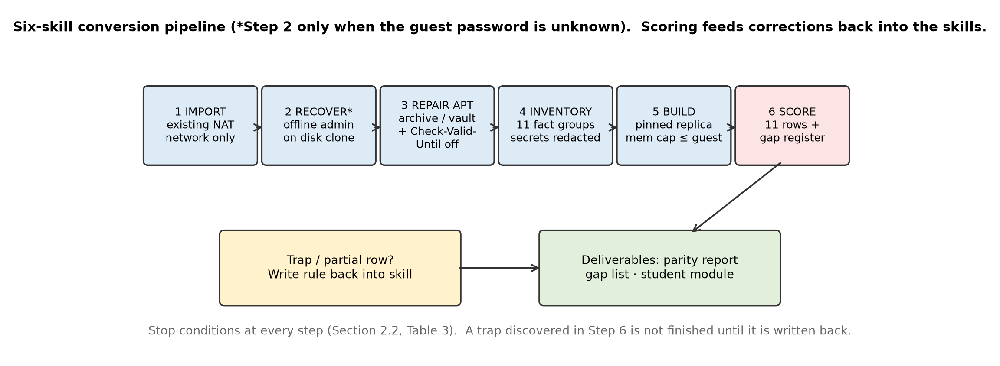
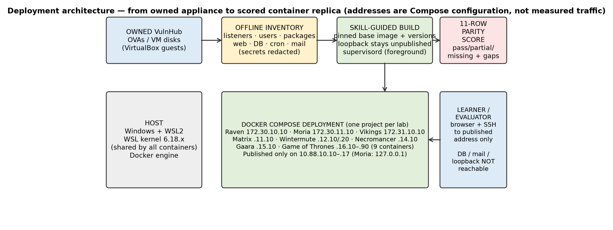
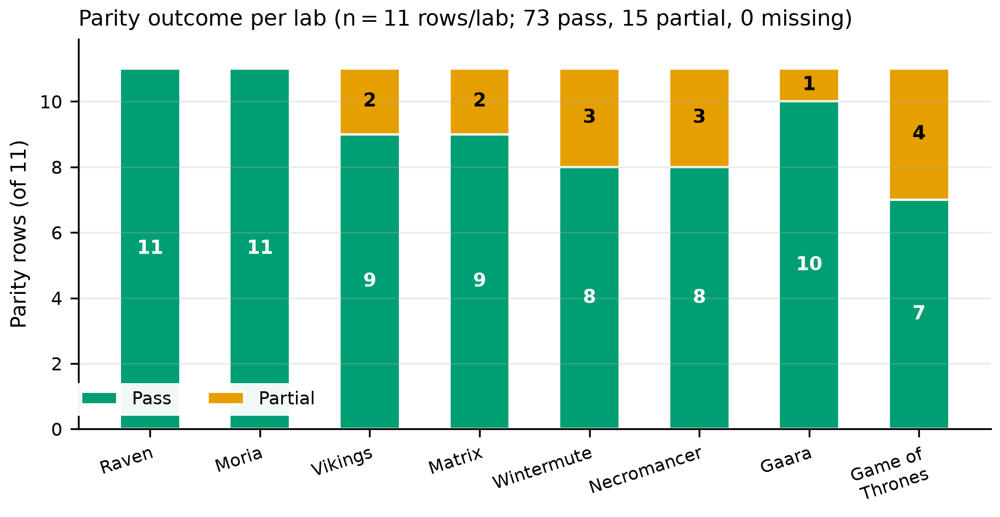
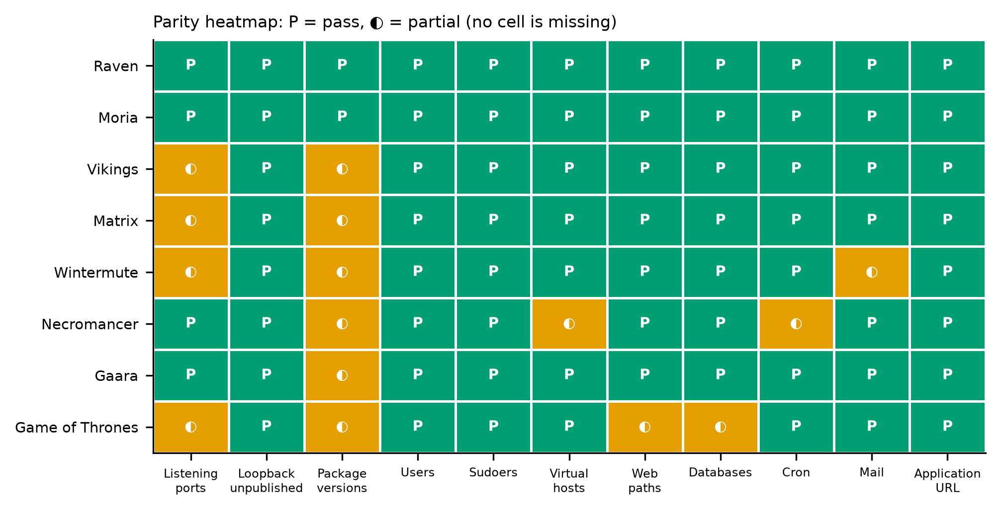
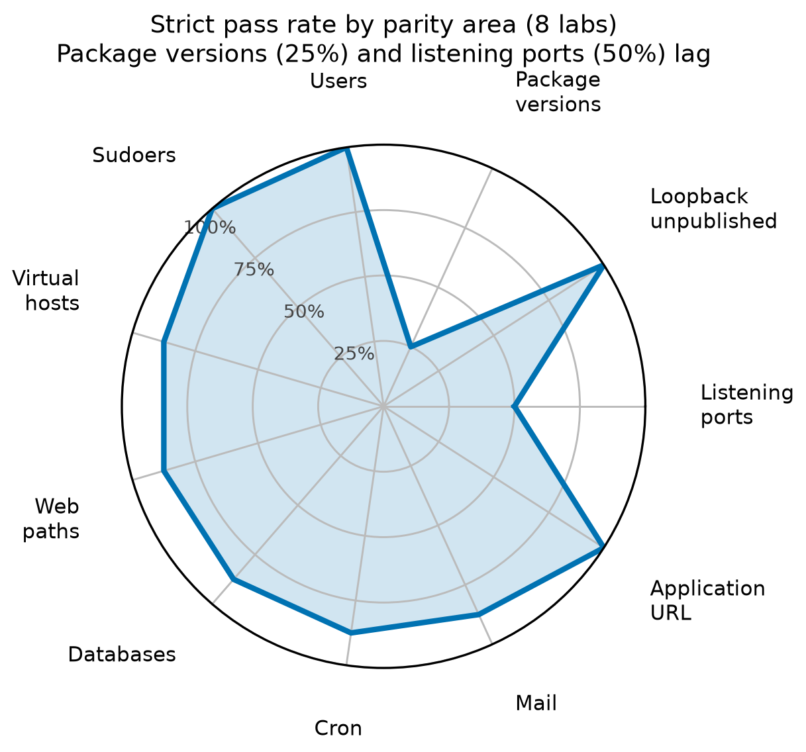
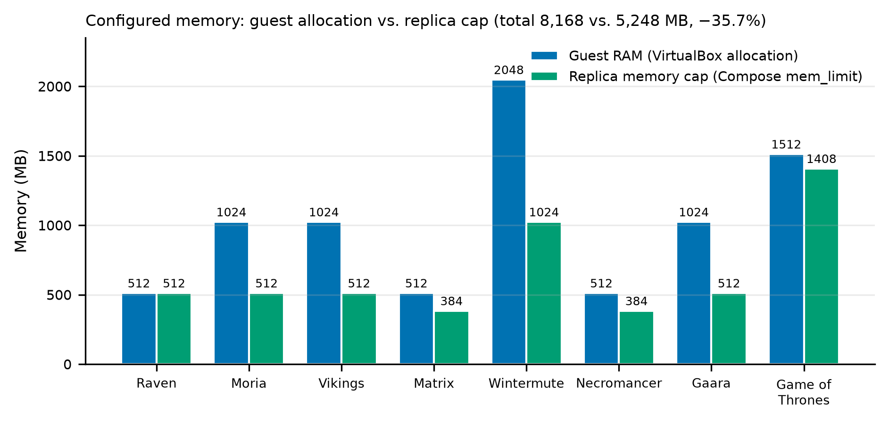
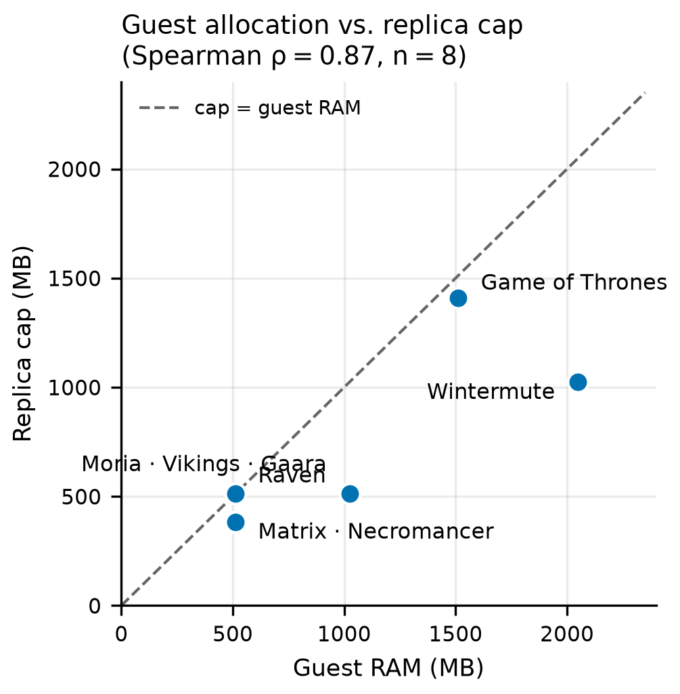
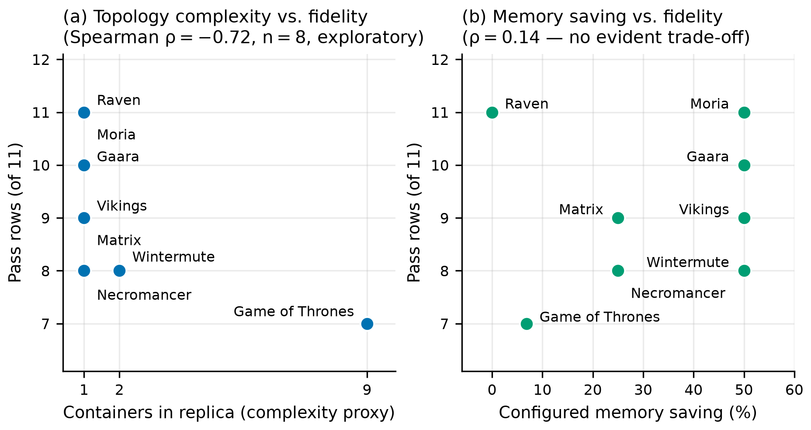
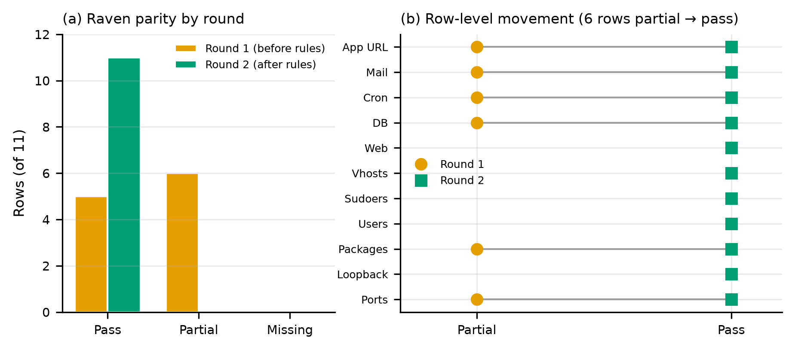
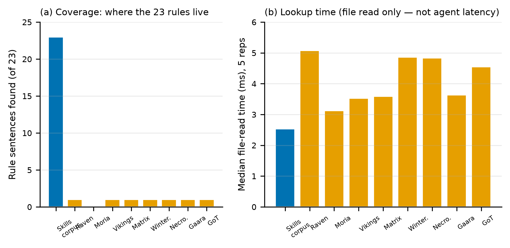

# ZeroCrowd-Labs: From Owned Virtual Appliances to Scored Container Replicas

ZeroCrowd-Labs converts owned, VulnHub-style virtual-machine appliances into lighter Docker Compose replicas while preserving the laboratory host's published services, accounts, service versions, scheduled jobs, mail listeners, application state, and—critically—its unpublished loopback-only services.

The project is not based on the weak criterion that “the page loads.” Each replica is scored against the original guest with an **11-row configuration-parity rubric**. A replica can therefore be operational but still incomplete: it may answer HTTP while using the wrong database engine, a newer package revision, a rewritten application URL, or a missing mail listener.

> **Evidence boundary used throughout this document**
>
> - The **primary evaluation corpus** contains eight labs and 88 parity rows.
> - MrRobot is reported separately as a **ninth-lab sensitivity case**.
> - Memory values are **configured allocations and Compose limits**, not measured resident memory.
> - Lookup milliseconds are script file-read times, not language-model or agent latency.
> - Configuration parity does not claim kernel equivalence, exploit-path equivalence, or byte-for-byte application behaviour.

## Contents

- [1. Project overview](#1-project-overview)
  - [a. Introduction](#a-introduction)
  - [b. Related work](#b-related-work)
  - [c. Contribution](#c-contribution)
  - [d. Methodology](#d-methodology)
- [2. Architecture](#2-architecture)
- [3. Evaluation–Results](#3-evaluationresults)
- [4. Conclusions](#4-conclusions)

---

# 1. Project overview

## a. Introduction

Hands-on cybersecurity laboratories depend on hosts that learners can enumerate, log in to, inspect, and administer. Community virtual-machine appliances package those hosts conveniently, but every appliance carries a complete guest operating system: its own kernel, disk image, init system, and reserved memory allocation.

Docker containers offer a lighter delivery mechanism. A container shares the host kernel and can be rebuilt from a pinned userspace, started as a Compose project, and capped below the original guest's memory allocation. That efficiency creates a measurement problem:

> A container replica may expose the expected port while no longer reproducing the same laboratory host.

For example, a replica could:

- substitute MariaDB for the guest's MySQL server;
- install a newer end-of-life package revision than the guest carried;
- publish a database or mail service that the guest kept on loopback;
- omit a cron fragment installed by a package;
- rewrite a stored WordPress URL to a raw IP address;
- report a mail daemon as stopped before its delayed listeners appear; or
- silently replace the guest kernel and init system with the host kernel and a process supervisor.

ZeroCrowd-Labs addresses this problem through three connected mechanisms:

1. **A six-skill conversion procedure** that records preconditions, actions, stop conditions, and closing verification for importing, administering, repairing, inventorying, building, and scoring an appliance.
2. **An 11-row parity rubric** that scores listening ports, loopback containment, package versions, users, sudoers, virtual hosts, web paths, databases, cron, mail, and the application URL as **pass**, **partial**, or **missing**.
3. **A non-promotable gap register** that permanently records what a container cannot reproduce—especially the guest kernel, guest init system, and archive or vault package sources—so those differences cannot be hidden inside a passing score.

### Project at a glance

| Item | Description |
|---|---|
| Project | ZeroCrowd-Labs |
| Input | Owned Linux/BSD virtual-machine appliances, principally VulnHub-style laboratory guests |
| Output | One Docker Compose replica project per laboratory case |
| Conversion method | Six persistent procedural skills applied in precondition order |
| Fidelity measure | Eleven-row pass/partial/missing configuration-parity rubric |
| Primary corpus | 8 labs, 88 scored rows |
| Sensitivity corpus | 9 labs including MrRobot, 99 scored rows |
| Primary result | **73 pass / 15 partial / 0 missing (83.0%)** |
| Sensitivity result | **81 pass / 18 partial / 0 missing (81.8%)** |
| Configured memory | 5,248 MB of replica caps versus 8,168 MB of guest RAM in the primary corpus |
| Strongest areas | Users, sudoers, loopback containment, and application URL: 8/8 labs each |
| Weakest areas | Package versions: 2/8 strict passes; listening ports: 4/8 strict passes |
| Main artifacts | Guest inventories, Dockerfiles, Compose files, parity reports, educational modules, skills, figures, and validation code |
| Safety model | Owned appliances only; secrets redacted; loopback-only guest services remain unpublished |

The primary corpus passes 73 of 88 rows. No row is missing. The 15 partial rows are not unexplained failures: each names a substitution or evidence limitation. Package versions and listening ports account for most strict-pass failures.

## b. Related work

ZeroCrowd-Labs sits between four bodies of work: cyber-range design, container-versus-VM research, reproducible software environments, and infrastructure or agent-procedure verification. Each explains part of the problem, but none defines when a rebuilt container reproduces a **specific owned appliance**.

### Cyber ranges and hands-on security laboratories

Cyber-range taxonomies describe architectures, scenarios, functions, and tooling for security exercises ([Yamin et al., 2020](https://doi.org/10.1016/j.cose.2019.101636)). Reviews of cyber ranges and testbeds likewise identify provisioning cost, reset time, scalability, and composability as central concerns ([Ukwandu et al., 2020](https://doi.org/10.3390/s20247148)).

The SEED project established the value of standardised, reproducible hands-on security exercises ([Du, 2007](https://doi.org/10.1145/1227504.1227474)). Labtainers demonstrated that Docker containers can deliver consistent, individually parameterised exercises with automated assessment on modest hardware ([Thompson & Irvine, 2018](https://doi.org/10.1109/MSP.2018.1870862)). SecGen took a different approach: instead of preserving one appliance, it generated randomised vulnerable virtual-machine scenarios (Schreuders et al., 2017).

Container-native ranges go further toward automated scenario construction. UNIWA's platform builds complex topologies on container services (Chouliaras et al., 2023, https://doi.org/10.7717/peerj-cs.1574), while CyExec* reports high vulnerability reproducibility with substantially lower memory and storage than VM scenarios ([Nakata & Otsuka, 2021](https://doi.org/10.1109/ACCESS.2021.3101245)). Those systems primarily optimise **scenario delivery**. ZeroCrowd-Labs asks a different question: whether a rebuilt container reproduces the listeners, package revisions, identities, application state, and containment boundaries of one particular guest.

### Containers, virtual machines, and the limits of substitution

Performance comparisons show why containers are attractive replacements for many VM workloads: containers can match or exceed VM performance on many measures because they avoid a second kernel and hypervisor boundary (Felter et al., 2015). Docker's packaging model also makes environments easier to distribute and restart (Boettiger, 2015, https://doi.org/10.1145/2723872.2723882).

The same architectural property creates the fidelity limit. Containers share the host kernel, normally replace the guest init system, and may be rebuilt from newer packages. Container-security research therefore treats the shared kernel as both an efficiency mechanism and a security boundary (Sultan et al., 2019, https://doi.org/10.1109/ACCESS.2019.2911732).

ZeroCrowd-Labs does not hide that limit. It records the shared kernel and supervisor substitution in every lab's gap register, even when all 11 configuration rows pass.

### Reproducible builds and end-of-life package archaeology

Docker is often presented as a remedy for computational irreproducibility: an image can state its base system and package versions rather than relying on an undocumented workstation (Boettiger, 2015). Research on Debian's historical archive shows why old environments are difficult to reconstruct after suites leave current mirrors ([Caneill et al., 2017](https://doi.org/10.1007/s10664-016-9461-5)). An archive may:

- move a suite to `archive.debian.org` or `old-releases.ubuntu.com`;
- serve a Release file outside its validity window;
- use an expired signing key;
- remove the exact package revision installed in the guest; or
- serve a newer security revision with the same functional role but a different version string.

The conversion therefore needs more than “use Docker.” It needs explicit rules for when an archive may be trusted, how a snapshot is pinned, when `trusted=yes` is permissible, and how that repair remains visible in the final report.

### Infrastructure verification and procedural knowledge

Infrastructure-as-code research has repeatedly found that configuration code lacks practical tests and that apparently successful automation can conceal non-idempotent or under-specified behaviour (Guerriero et al., 2019; Hummer et al., 2013; Shambaugh et al., 2016). The parity rubric applies that verification idea empirically: a running replica is compared with a redacted guest inventory using live listeners, package queries, HTTP responses, and parsed sudo rules.

Agent research usually generates a plan inside a task episode. A ZeroCrowd-Labs skill inverts that arrangement. The procedure exists **before** the episode, states when it applies, and tells the operator or agent when to stop. The evaluation consequently asks not only whether the finished replica works, but where the decision rules reside and whether they survive after the session ends.

### Positioning against related work

| Work or tradition | Main unit delivered | Fidelity question addressed | EOL-package treatment | Persistent procedure | Structural gaps |
|---|---|---|---|---|---|
| Cyber-range surveys | Range architecture and scenario taxonomy | Platform capability | Not central | No | Discussed generally |
| SEED and Labtainers | Educational exercises | Exercise consistency and assessment | Current exercise images | Exercise instructions | Not the main object |
| SecGen | Generated vulnerable VMs | Scenario variability | VM image generation | Generation framework | Not scored as replica gaps |
| UNIWA CR and CyExec* | Container-based ranges | Scenario reproducibility and resource use | Range build system | Platform workflow | Kernel limits recognised |
| VM/container performance and security studies | Workload platform | Performance or isolation | Not central | No | Shared kernel analysed |
| Docker reproducibility and Debian history | Rebuildable environment | Version and build reproducibility | Archives and historical packages | Dockerfile practice | Provenance may remain implicit |
| IaC verification | Configuration automation | Idempotence and configuration correctness | Not central | Tests and checks | Test failures reported |
| General agent benchmarks | Task episode | Whether a task is completed | Not addressed | Usually generated in-episode | Not represented as a permanent register |
| **ZeroCrowd-Labs** | **Replica of a specific owned VM** | **11-row guest-to-replica parity** | **Archive, vault, snapshot, and trust rules** | **Six ordered skills with stop conditions** | **Kernel, init, and archive gaps are non-promotable** |

The research gap is the combination: a VM-specific parity rubric, explicit EOL trust rules, a persistent conversion procedure, and a gap register that cannot be converted into a pass.

## c. Contribution

ZeroCrowd-Labs makes five principal contributions.

### C1. A skill-guided VM-to-container conversion procedure

Six procedural documents convert tacit session knowledge into a repeatable pipeline:

1. import an appliance without changing unrelated guests;
2. recover local administration offline when necessary;
3. repair end-of-life package sources under narrow trust conditions;
4. inventory the guest with secrets redacted;
5. build a pinned Compose replica; and
6. score the running replica independently of the build recipe.

Each skill specifies prerequisites, procedure, stop conditions, and evidence that closes the step. This matters because the dangerous errors are usually precondition errors: building before inventorying, trusting a current mirror, publishing a loopback service for convenience, or treating a Dockerfile as proof that a service is running.

### C2. An 11-row configuration-parity rubric

The rubric defines completeness across:

1. listening ports;
2. unpublished loopback services;
3. package versions;
4. users;
5. sudoers;
6. virtual hosts;
7. web paths;
8. databases;
9. cron;
10. mail; and
11. application URL.

Its most important security rule is inverted relative to convenience: **publishing a service that the guest kept on loopback is scored missing**, not treated as an improvement or an acceptable deployment difference.

### C3. A non-promotable gap register

Every lab separately records:

- package or service substitutions;
- archive, snapshot, or vault package sources;
- absence of the guest kernel (`second kernel: no`);
- replacement of guest init by supervisord, a shell entrypoint, or a daemon foreground mode;
- unrecreated network interfaces or collapsed guest networks;
- unloaded packet-filter rules; and
- the fact that memory is configured rather than measured.

The register prevents an otherwise successful container from being described as a second virtual machine.

### C4. A validated multi-laboratory evaluation

The method is evaluated over eight primary labs spanning Debian, Ubuntu, CentOS, a Slackware-style live system, and OpenBSD. The corpus includes single-container replicas, a two-guest/two-container case, and a nine-container topology reconstructed from a guest that itself acted as a Docker host.

All headline values are re-derived from the repository's inventories, Compose files, parity reports, and experiment files by `paper/validate.py`. The audit also identified and separated three issues that prose alone had obscured:

1. MrRobot had in fact been converted and scored, so it is treated as a sensitivity case rather than silently changing the primary corpus.
2. Container bridge addresses, published replica addresses, and student host-only addresses are distinct network layers.
3. Different lookup runs used different corpora and must not be pooled as one timing result.

### C5. Evidence that procedural rules reside outside finished build files

A controlled lookup study searched for 23 coded conversion-rule sentences. The skill corpus contained all 23. The eight primary lab build/inventory corpora contained only 7 hits across 184 opportunities. This supports a narrow but important conclusion: finished Dockerfiles record many **decisions**, but they usually do not preserve the conditions under which those decisions are valid or should be changed.

### Contribution-to-evidence map

| Contribution | Artifact in the repository | Evaluation evidence |
|---|---|---|
| Six-skill conversion pipeline | `skills/importing-ova-nat-network/`, `recovering-linux-admin-offline/`, `repairing-eol-apt-archives/`, `inventorying-linux-vm/`, `building-docker-vm-replica/`, `evaluating-docker-vm-parity/` | Same procedure applied across eight primary labs |
| Parity rubric | `skills/evaluating-docker-vm-parity/SKILL.md`; each lab's `replica-parity.md` | 73 pass / 15 partial / 0 missing out of 88 |
| Gap register | Gap sections in each `replica-parity.md` | Kernel/init/archive limitations remain explicit even for 11/11 labs |
| Validated dataset | `paper/data/dataset.py`, `paper/validate.py`, `paper/VALIDATION.md` | Automated recomputation returns `ALL OK` |
| Rule-residence study | `labs/vikings-lab/experiment-sentences.txt`, lab `experiment.md` files | Skills 23/23; finished primary-lab files 7/184 in Experiment A |
| Teaching transfer | `Educational-Module.md` and per-lab modules | Learners rebuild topologies on current Debian 12 without receiving the historical vulnerable image |
| Scenario design | `skills/designing-lab-scenarios/` | New lab briefs reuse topology and exposure patterns without attack paths or credentials |

## d. Methodology

The study is an **artifact-centred case series** with three embedded forms of evidence:

1. a cross-lab parity and configured-memory evaluation;
2. a single-case longitudinal comparison of Raven before and after rule codification; and
3. a controlled text-residence study comparing skills with finished lab files.

### Research questions

| ID | Research question | Unit of analysis | Main evidence | Interpretation |
|---|---|---|---|---|
| RQ1 | How completely do skill-guided replicas reproduce their guests, and where do partial rows concentrate? | Parity row, grouped by lab | 88 rows across eight labs | Descriptive; rows within a lab are clustered, not independent trials |
| RQ2 | How do configured replica memory caps compare with guest RAM, and is fidelity associated with saving or topology? | Lab | Guest allocation, Compose cap, container count, pass count | Descriptive plus clearly labelled exploratory rank correlations |
| RQ3 | What changed in Raven when conversion rules were codified? | Raven parity row across two rounds | Same 11-row rubric before and after | Single-case mechanism evidence; no causal population claim |
| RQ4 | Do decision rules reside in skill documents or in finished build files? | 23 exact rule sentences | Skills corpus and per-lab finished-file corpora | Exact-string residence; file-read time is not agent latency |

No null-hypothesis test is claimed for RQ1 or RQ2. Spearman correlations are exploratory because there are only eight heterogeneous labs. Raven is a before/after observation in one case, not a controlled trial. The lookup study measures textual residence, not comprehension or task speed.

### Six-skill conversion pipeline



**Figure 1 — Six-skill conversion pipeline.** The order is determined by preconditions. A build consumes inventory facts rather than guesses; archive repair makes old package systems usable; and a trap discovered during scoring is written back into the responsible skill before the conversion is treated as finished.

| Step | Skill | Purpose | Important stop condition | Closing evidence |
|---:|---|---|---|---|
| 1 | `importing-ova-nat-network` | Register exactly one owned appliance on an existing VirtualBox NAT network | NAT network absent, name collision, or another VM changed | Before/after VM lists differ only by the new guest |
| 2 | `recovering-linux-admin-offline` | Recover local administration from a powered-off disk clone when the password is unknown | Next action would become an online attack; encrypted root without a passphrase | Administrator login verified; no password or hash written to the report |
| 3 | `repairing-eol-apt-archives` | Move an EOL Debian/Ubuntu suite to its archive and repair expired validity or signatures | Mirror is still current, rewritten archive still returns 404, or trust would extend beyond archived lines | `apt-get update` and a simulated installation exit successfully |
| 4 | `inventorying-linux-vm` | Record the guest facts needed to build and score the replica | A secret, password hash, key, or flag value would be printed | Eleven fact groups recorded with provenance and redactions |
| 5 | `building-docker-vm-replica` | Build a pinned Compose replica with a memory cap no greater than guest RAM | Database is non-local for the single-container pattern, or a loopback service would be published | Image built, container running, and Compose inspection confirms address, cap, and bindings |
| 6 | `evaluating-docker-vm-parity` | Score the running replica against the inventory | Inventory missing, replica state unknown, or a check would require attacking a service | Eleven rows scored and gap register completed |

Step 2 is conditional: it is used only when local administration is unavailable. Step 3 is written for Debian and Ubuntu; CentOS guests use the analogous vault-mirror repair. A seventh skill, `designing-lab-scenarios`, is outside the conversion chain and is used to draft new teaching scenarios from existing topology patterns.

### The parity rubric

| # | Row | Pass requires | Typical partial | Missing includes |
|---:|---|---|---|---|
| 1 | Listening ports | Same published and internal listener roles are present, with live evidence preferred | A listener is replaced, absent until use, or supported only by startup configuration | An inventoried listener is absent |
| 2 | Loopback unpublished | Every guest loopback-only service remains absent from host publication | — | A guest loopback service is published |
| 3 | Package versions | Inventoried version strings match through `dpkg-query` or `rpm -q` | Archive serves a newer revision or a substitute package | A defining service package is absent |
| 4 | Users | Same human users, UID, home, and shell; any operator account is disclosed | Account set differs by a documented operational addition | An inventoried user is absent |
| 5 | Sudoers | Same privilege rules and `visudo -c` succeeds | — | A required privilege rule is absent or invalid |
| 6 | Virtual hosts | Same virtual-host set, names, and document roots | A substitute web server reproduces only part of the host structure | An inventoried virtual host is absent |
| 7 | Web paths | Same paths exist and return the expected HTTP status | Part of a web tree or application path is not copied | A defining web path is absent |
| 8 | Databases | Same engine and application database state; “none/none” can pass | MariaDB substitutes for MySQL or data are only partly reproduced | The application database is absent |
| 9 | Cron | Same root, user, and `cron.d` jobs | A job exists but guest periodic programs are absent | An inventoried job is absent |
| 10 | Mail | Same mail package and listeners; “none/none” can pass | Version string differs or a mail component is substituted | An inventoried mail listener is absent |
| 11 | Application URL | Stored URL is unchanged and answers at the published address | URL rewritten to a raw address or a different path | The stored application endpoint does not answer |

A **partial** is therefore a positive, specific claim: the function exists, but a named property differs. A **missing** row means the function is absent, a non-running replica cannot evidence it, or a loopback-only guest service was exposed.

### Evidence discipline

Three rules keep the results auditable:

1. **Configuration is not measurement.** Compose `mem_limit` and VirtualBox RAM are allocations. They are never described as resident-set size, startup time, throughput, or observed energy use.
2. **Provenance is data.** Raven, Moria, and Vikings were inventoried from booted guests. Gaara, Matrix, Wintermute, Necromancer, and Game of Thrones were inventoried from configuration and startup files because those guests could not be booted reliably in the available host environment. Their listener rows are consequently weaker evidence.
3. **Absence is reported.** Missing version strings, unbooted guests, unloaded packet filters, unrecreated interfaces, and non-redistributable disk material remain absent or explicit. They are not reconstructed silently.

### Primary dataset

| Lab | Guest system | Guest RAM (MB) | Replica cap (MB) | Compose services | Published endpoint | Inventory evidence |
|---|---|---:|---:|---:|---|---|
| Raven | Debian 8.11 (jessie) | 512 | 512 | 1 | `10.88.10.10` | Live, serial console |
| Moria | CentOS 7.3.1611 | 1,024 | 512 | 1 | `127.0.0.1` | Live, serial console |
| Vikings | Ubuntu 18.04 (bionic) | 1,024 | 512 | 1 | `10.88.10.11` | Live, booted guest |
| Matrix | Porteus 4.0, Slackware-style | 512 | 384 | 1 | `10.88.10.12` | Configuration only |
| Wintermute | Debian 9 + Ubuntu 16.04 | 2,048 | 1,024 | 2 | `10.88.10.13`, `10.88.10.14` | Configuration only |
| Necromancer | OpenBSD 5.9 | 512 | 384 | 1 | `10.88.10.15` | Configuration only |
| Gaara | Debian 10 (buster) | 1,024 | 512 | 1 | `10.88.10.16` | Configuration only |
| Game of Thrones | Debian 9 (stretch) | 1,512 | 1,408 | 9 | `10.88.10.17` | Configuration only |
| **Primary total** | **8 lab cases** | **8,168** | **5,248** | **17** | — | **3 live / 5 configuration** |

Wintermute aggregates two guests and two containers. Game of Thrones begins as one guest that itself operated as a Docker host and is reproduced as nine single-purpose containers. The nine-lab sensitivity corpus adds MrRobot (Ubuntu 14.04, 512 MB guest RAM, 384 MB cap, one container, `10.88.10.18`), producing totals of 8,680 MB guest RAM and 5,632 MB of configured caps.

---

# 2. Architecture

## System architecture

ZeroCrowd-Labs has five architectural layers:

1. **Owned-appliance layer** — the original OVA/VM and its disk, kept outside the redistributable repository material.
2. **Procedure layer** — six skills that govern import, recovery, package repair, inventory, build, and scoring.
3. **Evidence layer** — redacted guest inventories, parity reports, Compose configuration, Dockerfiles, and experiment records.
4. **Replica runtime layer** — one Docker Compose project per lab, normally on a dedicated bridge subnet and published only at a controlled local address.
5. **Teaching layer** — educational modules that reuse the topology and account patterns on a current Debian 12 student VM without distributing the historical vulnerable system.



**Figure 2 — Deployment architecture.** The top row is the conversion path: owned appliance → offline inventory → skill-guided build → parity score. The bottom row is the runtime: a Windows + WSL2 host runs one Compose project per lab, while learners or evaluators can reach only the published address. Database, mail, and other guest-loopback services are present inside replicas where required but are not reachable from the published endpoint unless the guest itself published them.

## Component responsibilities

| Component | Inputs | Responsibilities | Outputs |
|---|---|---|---|
| VirtualBox import | Owned OVA/OVF and an existing NAT network | Register one guest without changing unrelated VMs | Imported guest and before/after VM evidence |
| Offline recovery | Powered-off disk clone | Add or repair local administration without online attack steps | Verified administrator login |
| EOL package repair | Old Debian/Ubuntu or CentOS package configuration | Point suites to archive/vault, repair validity and signature handling narrowly | Working package installation and a registered archive gap |
| Guest inventory | Running guest or its unit/configuration files | Record listeners, identities, packages, web, database, cron, and mail with redactions | `vm-inventory.md` |
| Replica build | Inventory, base image, package pins, service configuration | Build containers, preserve port numbers, initialise application data once, cap memory | Dockerfile, entrypoint, supervisor configuration, `compose.yaml` |
| Compose deployment | Replica image and lab Compose project | Assign bridge addresses, publish approved ports, enforce caps | Running lab replica |
| Parity evaluation | Inventory and running replica | Query listeners, package strings, HTTP paths, users, sudo rules, cron, mail, and URL | `replica-parity.md` with 11 rows and gap register |
| Teaching module | Inventory and topology | Rebuild the exercise on a current Debian 12 VM with learner-chosen credentials | Per-lab `Educational-Module.md` |
| Scenario designer | Existing inventories and topologies | Draft new hosts, roles, published ports, and loopback services | New lab brief without attack path, password, or flag |

## Repository architecture

| Path | Architectural role |
|---|---|
| `labs/<lab>/vm-inventory.md` | Guest evidence used as the conversion target |
| `labs/<lab>/docker-compose.yml` | Lab entry point; normally includes `replica/compose.yaml` |
| `labs/<lab>/replica/` | Dockerfile, service configuration, entrypoint, and Compose definition where applicable |
| `labs/<lab>/replica-parity.md` | Eleven-row result, substitutions, and gap register |
| `labs/<lab>/Educational-Module.md` | Student rebuild instructions for that topology |
| `skills/` | Six conversion skills plus the scenario-design skill |
| `Educational-Module.md` | Index of the teaching surface |
| `resources/` | Student-copied site files, images, and shared VM setup material |
| `paper/data/dataset.py` | Single numerical source used to generate the evaluation figures |
| `paper/make_figures.py` | Regenerates all paper figures from the validated dataset |
| `paper/validate.py` | Re-parses repository evidence and fails if a headline value differs |

Disk images, appliance archives, password files, and shadow extracts are intentionally absent. The inventory, build, and score remain separate files so the audit can be performed without secrets and so the rule-residence experiment has a well-defined “finished files” corpus.

## Network architecture

Three address layers must not be confused.

| Layer | Address family | Purpose | Visibility |
|---|---|---|---|
| Replica bridge network | `172.30.*` and `172.31.*` | Static container addresses inside each lab's Docker bridge | Internal to the Docker deployment |
| Published replica endpoint | Primarily `10.88.10.10`–`10.88.10.17` | Learner/evaluator access to inventoried non-loopback guest ports | Controlled local publication |
| Student host-only network | `192.168.56.0/24` | Teaching rebuilds on a learner-owned Debian 12 VM | Host-only exercise network |

Moria is the documented publication exception: its replica publishes ports 21, 22, and 80 on `127.0.0.1` rather than on a `10.88.10.*` address.

Publication follows the guest rather than operational convenience:

- the guest's original non-loopback port numbers are preserved;
- a port is not renumbered merely because the host port is busy;
- loopback-only services remain inside the container and receive no Compose `ports` mapping;
- Docker's embedded resolver is not published;
- the guest hostname can be mapped to the published endpoint so a stored application URL remains unchanged; and
- databases, mail submission, Redis, SNMP, administrative listeners, and similar guest-private services remain unreachable from the published address unless the guest published them.

## Runtime and build architecture

Replica base images follow the guest where a compatible Linux container base exists.

| Lab | Replica base or bases | Architectural reason |
|---|---|---|
| Raven | `debian:jessie` | Guest distribution can be the container base; exact revisions are pinned from dated snapshots |
| Moria | `centos:7.3.1611` | CentOS vault supplies the guest's RPM version strings |
| Vikings | `ubuntu:18.04` | Guest distribution remains available as an EOL base |
| Matrix | `python:2.7.14` | Slackware-style Porteus cannot be the Linux container base; the interpreter version is the reproducible anchor |
| Wintermute | Debian 9 and Ubuntu 16.04 bases | Two guest systems become two containers |
| Necromancer | Debian 11 with nginx | OpenBSD 5.9 cannot be a Linux container base; OpenBSD `httpd` is a disclosed substitution |
| Gaara | `debian:10` | Guest distribution can be the base, but archive revisions have drifted |
| Game of Thrones | Debian 9 family, nine services | The guest's own Docker-host topology is reproduced as independent single-purpose containers |
| MrRobot (sensitivity) | `ubuntu:14.04` | Converted later and scored separately from the primary corpus |

Three runtime mechanics recur across the corpus:

1. **Foreground supervision.** Long-running services are supervised in their foreground form. In particular, `sendmail -bD` is used rather than the forking `sendmail -bd`, so supervisor state corresponds to a process that remains present.
2. **Socket-based scoring.** Mail and database rows are scored from actual sockets and application paths after startup. Sendmail can take roughly a minute before ports 25/587 appear; an early supervisor check would produce a false failure.
3. **One-time database initialisation.** Application databases are initialised once, and the runtime is pointed at the socket that the installed server creates. A volume created by MariaDB is not silently mounted into MySQL, or vice versa.

## Security and containment architecture

The replicas intentionally reproduce old and vulnerable service configurations for owned, local laboratories. They are therefore contained by design:

- only owned appliances are imported or modified;
- offline administration is performed on a disk clone, not through an online attack;
- inventories replace passwords, hashes, private keys, and flags with redaction tokens;
- guest-loopback services stay unpublished;
- replicas bind to dedicated local addresses rather than all host interfaces;
- archive trust exceptions apply only to archived package lines;
- the shared host kernel and init substitution are registered as gaps; and
- student modules rebuild the topology on current Debian 12, use learner-chosen passwords, and set `PermitRootLogin no`.

## Running a replica

Each lab is an independent Compose project:

```bash
docker compose -f labs/gaara-lab/docker-compose.yml up -d
```

The top-level Compose file includes that lab's `replica/compose.yaml`. A lab should be stopped and removed through the same project file so its bridge network, containers, and volumes remain associated with the correct lab.

---

# 3. Evaluation–Results

## Evaluation design

The evaluation combines corpus scoring with a longitudinal case and an exact-string lookup study.

| Study element | Protocol |
|---|---|
| Primary corpus | Eight labs, 11 rows per lab, 88 rows |
| Sensitivity corpus | Primary corpus plus MrRobot, 99 rows |
| Scoring | Pass, partial, or missing from inventory and replica evidence |
| Main live checks | Listening sockets, `dpkg-query` or `rpm -q`, HTTP status, users, `visudo -c`, cron files, mail listeners, and stored URL |
| Memory comparison | VirtualBox guest allocation versus Compose `mem_limit` |
| Longitudinal case | Raven scored before and after the conversion rules were written into the skills |
| Lookup Experiment A | 23 rule sentences searched in the three relevant skills and in each primary lab's finished files; five repetitions; median reported |
| Lookup Experiment B | Separately assembled per-lab lookup files for seven labs; not pooled with Experiment A |
| Audit | `paper/validate.py` re-parses parity reports, Compose files, and experiment files and fails on a headline mismatch |

The 95% Wilson interval is included to communicate scale. It is not a population inference because rows are clustered within heterogeneous labs. The two Spearman correlations are exploratory and hypothesis-generating only.

## RQ1 — Fidelity across eight replicas

Across the primary corpus, the replicas achieve:

- **73 pass** rows;
- **15 partial** rows;
- **0 missing** rows; and
- a strict pass proportion of **83.0%** (95% Wilson interval **73.8–89.4%**).

| Lab | Pass | Partial | Missing | Rows that remained partial |
|---|---:|---:|---:|---|
| Raven | 11 | 0 | 0 | — |
| Moria | 11 | 0 | 0 | — |
| Gaara | 10 | 1 | 0 | Package versions |
| Vikings | 9 | 2 | 0 | Listening ports, package versions |
| Matrix | 9 | 2 | 0 | Listening ports, package versions |
| Wintermute | 8 | 3 | 0 | Listening ports, package versions, mail |
| Necromancer | 8 | 3 | 0 | Package versions, virtual hosts, cron |
| Game of Thrones | 7 | 4 | 0 | Listening ports, package versions, web paths, databases |
| **Total** | **73** | **15** | **0** | Package versions in 6/8 labs |



**Figure 3 — Parity outcome by lab.** Raven and Moria reproduce all 11 rows. Game of Thrones is lowest at seven passes, but its four remaining rows are partial rather than missing: the relevant functions exist with named substitutions or incomplete copied state. No lab has an absent row under the rubric.

Adding MrRobot's 8 pass / 3 partial / 0 missing produces the sensitivity result **81/99 (81.8%)**, with no change to the interpretation.

### Which areas reproduce most reliably?

| Parity area | Pass (labs) | Partial (labs) | Strict pass rate |
|---|---:|---:|---:|
| Listening ports | 4 | 4 | 50.0% |
| Loopback unpublished | 8 | 0 | 100% |
| Package versions | 2 | 6 | 25.0% |
| Users | 8 | 0 | 100% |
| Sudoers | 8 | 0 | 100% |
| Virtual hosts | 7 | 1 | 87.5% |
| Web paths | 7 | 1 | 87.5% |
| Databases | 7 | 1 | 87.5% |
| Cron | 7 | 1 | 87.5% |
| Mail | 7 | 1 | 87.5% |
| Application URL | 8 | 0 | 100% |



**Figure 4 — Parity heatmap.** The amber cells form two principal columns. Package versions are partial in six labs, and listening ports are partial in four. In contrast, the identity and containment columns—users, sudoers, loopback publication, and the stored application URL—are uniformly green. The replicas therefore reproduce **who may log in, what privilege they receive, and what must remain private** more reliably than they reproduce historical package strings or guest-runtime listener state.



**Figure 5 — Strict pass rate by rubric area.** The radar's two indentations summarise the fidelity frontier: package versions at 25% and listening ports at 50%. Every other area is at 87.5% or 100%. The conversion challenge is therefore not broadly distributed across the rubric; it concentrates in historical package archaeology and services whose existence depended on guest-runtime state.

### Why are the 15 rows partial?

| Primary cause | Rows | Labs or rows affected | Mechanism |
|---|---:|---|---|
| Archive-revision drift | 5 | Gaara; Vikings; Wintermute packages and mail; Game of Thrones | The EOL archive now serves a newer security revision than the guest's recorded string |
| Unreproducible guest substrate | 3 | Matrix packages; Necromancer packages and virtual hosts | Slackware or OpenBSD cannot serve directly as the Linux container base |
| Guest-runtime collapse | 4 | Vikings ports; Game of Thrones ports, web paths, and databases | Listeners or engines existed only as guest-runtime state and were replaced by stand-ins or incompletely copied trees |
| Live-evidence unavailable | 2 | Matrix ports; Wintermute ports | The guest was not booted, so listener evidence rests on unit, startup, or configuration files |
| Disclosed substitution | 1 | Necromancer cron | A replacement job is present, but OpenBSD periodic programs are absent |
| **Total** | **15** | — | — |

The results divide the conversion problem into two classes:

- **Procedure-correctable differences:** missing daemons, wrong database engines, lost cron fragments, premature mail scoring, and rewritten URLs can be fixed by rules.
- **Environment-constrained differences:** an archive's newer revision, a non-Linux guest substrate, or state created by a guest Docker/systemd runtime may remain partial even after correct procedure.

## RQ2 — Configured memory and its relation to fidelity

The primary replicas use **5,248 MB** of configured memory caps against **8,168 MB** of guest RAM:

\[
8{,}168 - 5{,}248 = 2{,}920\text{ MB}
\]

\[
\frac{2{,}920}{8{,}168} \times 100 \approx 35.7\%
\]

This is a reduction in configured ceiling, not a measured 35.7% saving in resident memory.



**Figure 6 — Configured memory by lab.** Raven retains its full 512 MB allocation. Moria, Vikings, Wintermute, and Gaara use half of the summed guest allocation; Matrix and Necromancer retain 75%; and Game of Thrones retains 93.1%, because its 1,408 MB is the sum of nine container caps. Wintermute combines two 1,024 MB guests into two 512 MB containers.



**Figure 7 — Guest allocation versus replica cap.** Every point lies on or below the `cap = guest RAM` line. The Spearman association is high (ρ = 0.87, n = 8), but that is primarily a design check: the build rule explicitly forbids exceeding the guest allocation. Labs with identical coordinates share a joint label—Matrix + Necromancer at (512, 384), and Moria + Vikings + Gaara at (1024, 512).



**Figure 8 — Exploratory fidelity associations.** Panel (a) shows a negative association between container count and pass rows (ρ = −0.72, n = 8), driven especially by Game of Thrones: nine containers and seven passes. Panel (b) shows no evident association between percentage memory saving and pass rows (ρ = 0.14). The exploratory interpretation is that **topological complexity, rather than a lower memory ceiling, is the greater fidelity risk in this corpus**. With only eight heterogeneous cases, neither relationship supports a causal or population claim.

## RQ3 — What codifying the rules changed in Raven

Raven is the only lab scored on the same 11 rows before and after the procedure was codified.

| Round | Pass | Partial | Missing | Strict pass rate |
|---|---:|---:|---:|---:|
| Round 1: before codified rules | 5 | 6 | 0 | 45.5% |
| Round 2: after codified rules | 11 | 0 | 0 | 100% |



**Figure 9 — Raven longitudinal comparison.** Panel (a) shows the count change from 5 pass / 6 partial to 11 pass / 0 partial. Panel (b) identifies the six rows that moved. Five rows already passed; none was missing in either round. The gap register—archive package sources, shared host kernel, and supervisord—did not become a pass and is deliberately outside the 11-row movement.

| Raven row | Fix applied | Rule preserved in the skills |
|---|---|---|
| Listening ports | Installed `nfs-common`; ran `rpcbind` with foreground `rpc.statd` | Score every inventoried listener from `ss`; a missing daemon is a build defect, not a note |
| Package versions | Rebuilt from `debian:jessie` and pinned guest revisions through dated snapshots | Do not call the row a pass until `dpkg-query` matches the inventory strings |
| Databases | Installed MySQL 5.5.60 on a fresh volume and removed the MariaDB substitution | Install the inventoried engine; never mount one engine's data directory into the other |
| Cron | Kept the distribution PHP `cron.d` fragment | A package-owned cron fragment absent from the replica makes the row partial |
| Mail | Pinned Sendmail 8.14.4, supervised `sendmail -bD`, and scored after approximately 60 seconds | Score mail from sockets after the startup window, not from early supervisor state |
| Application URL | Kept `http://raven.local/wordpress/` and mapped the hostname to `10.88.10.10` | Map the hostname to the published address; do not rewrite the stored URL |

Round 1 is instructive because the replica **worked** at a casual level: it answered HTTP. It nevertheless used Debian 9-era packages and MariaDB 10.1 in place of the guest's Debian 8 environment and MySQL 5.5. Under a “page loads” acceptance test, the conversion would have stopped six rows early.

This is a single-case, same-project before/after result. It demonstrates that the codified rules address the six observed failure modes; it does not prove that codification caused a general improvement for other agents or appliances.

## RQ4 — Where the conversion rules reside

Experiment A searched 23 exact rule sentences in two kinds of corpora:

- **With skills:** the apt-repair, replica-build, and parity-evaluation skill files.
- **Without skills:** each lab's finished build, inventory, and score files. Web trees, shadow extracts, and disk images were excluded.

| Corpus | Files searched | Rule sentences found | Hit rate | Median file-read time |
|---|---:|---:|---:|---:|
| Three skills | 3 | 23/23 | 100% | 2.539 ms |
| Raven files | 8 | 1/23 | 4.3% | 5.076 ms |
| Moria files | 5 | 0/23 | 0% | 3.123 ms |
| Vikings files | 6 | 1/23 | 4.3% | 3.532 ms |
| Matrix files | 6 | 1/23 | 4.3% | 3.589 ms |
| Wintermute files | 9 | 1/23 | 4.3% | 4.862 ms |
| Necromancer files | 9 | 1/23 | 4.3% | 4.835 ms |
| Gaara files | 7 | 1/23 | 4.3% | 3.641 ms |
| Game of Thrones files | 9 | 1/23 | 4.3% | 4.553 ms |



**Figure 10 — Where the 23 rules live.** Panel (a) is the result: all 23 coded rules occur in the skill corpus, while each lab corpus contains zero or one. Seven labs preserve only the `Acquire::Check-Valid-Until "false"` assignment, which necessarily survives in a Dockerfile or package-source file. Moria preserves none because its CentOS vault repair does not use that Debian/Ubuntu assignment. Panel (b) is included as a non-claim: all searches finish in single-digit milliseconds, and these script file-read times must not be interpreted as agent latency or task-completion speed.

Experiment B independently repeats the coverage pattern on per-lab files: the skills contain 23/23 rules in each run, while each replica corpus contains 1/23.

| Experiment B corpus | Skills median (ms) | Replica-file median (ms) | Replica-file coverage |
|---|---:|---:|---:|
| Gaara | 1.900 | 3.461 | 1/23 |
| Game of Thrones | 1.874 | 4.284 | 1/23 |
| Matrix | 0.593 | 0.562 | 1/23 |
| Necromancer | 1.724 | 4.127 | 1/23 |
| Vikings | 0.618 | 0.635 | 1/23 |
| Wintermute | 0.758 | 1.039 | 1/23 |
| MrRobot (sensitivity) | 2.129 | 4.050 | 1/23 |

The Matrix row is useful precisely because its replica-file median is slightly faster than the skills median. It confirms that the millisecond ordering is not stable evidence about agents. The robust result is **coverage**, not speed: 22 of the 23 tested decision rules are absent from the finished primary-lab artifacts.

Those absent rules include when archived signatures may be trusted, why loopback services stay unpublished, why a database-engine substitution remains partial, why the host kernel can never be called reproduced, and how long to wait before scoring mail. A later operator or agent given only Dockerfiles would inherit outcomes without most of their governing conditions.

## Sensitivity analysis

| Corpus | Labs | Rows | Pass | Partial | Missing | Strict pass | Guest RAM | Replica caps |
|---|---:|---:|---:|---:|---:|---:|---:|---:|
| Primary | 8 | 88 | 73 | 15 | 0 | 83.0% | 8,168 MB | 5,248 MB |
| Sensitivity | 9 | 99 | 81 | 18 | 0 | 81.8% | 8,680 MB | 5,632 MB |

Including MrRobot lowers the strict-pass percentage slightly, increases configured caps by 384 MB, and changes no qualitative conclusion:

- identity and loopback containment remain easier to reproduce than package versions;
- no row is missing;
- partials remain concentrated in archival versions and runtime-dependent listeners; and
- a lower configured memory ceiling does not by itself explain lower fidelity.

## Threats to validity and limitations

| Threat or limitation | Effect on interpretation |
|---|---|
| Construct validity | The rubric measures configuration equality and practical presence, not exploit success, full protocol fuzzing, workload replay, or byte-identical application behaviour |
| Evidence provenance | Five primary inventories were reconstructed from configuration files of unbooted guests; their listener rows are weaker than the three live inventories |
| Internal validity | The project built and scored its own replicas without independent re-scoring; scorer learning cannot be separated completely from rule codification in Raven |
| Small, heterogeneous corpus | Eight primary labs differ in operating system, topology, and evidence quality; row counts and correlations should not be generalised statistically |
| Rule-sentence selection | Experiment A/B test 23 coded sentences; another rule set could produce different coverage, although the same build corpora would still lack most precondition and reporting rules |
| Timing boundary | No second agent was timed and no agent resolve rate was measured; the study cannot claim that skills make an agent faster |
| Resource boundary | No resident memory, startup latency, throughput, or CPU use was measured; only allocations and caps were compared |
| Platform boundary | Results come from owned Linux/BSD, web-and-SSH-centred boot-to-root appliances on one Windows + WSL2/VirtualBox environment |
| Structural container limits | Shared kernel, supervisor substitution, unrecreated devices, packet filters, and some guest-runtime state cannot be made equivalent by better Dockerfile authoring |
| Safety boundary | Historical vulnerable services are suitable only for isolated, owned laboratory networks and must not be exposed as general-purpose services |

---

# 4. Conclusions

ZeroCrowd-Labs demonstrates that an owned virtual appliance can be converted into a substantially lighter Docker Compose replica without reducing fidelity assessment to “the service responds.” Across eight primary laboratories, the replicas pass **73 of 88 configuration-parity rows (83.0%)**, partially satisfy 15, and miss none. Their configured memory ceilings total **5,248 MB**, compared with **8,168 MB** of VirtualBox guest allocations.

The project reaches five main conclusions.

## 1. Container conversion is an archaeology and verification problem, not only a packaging problem

The difficult work is recovering what the guest actually was: package revisions, users, privilege rules, listeners, bind addresses, web roots, database engine, cron fragments, mail behaviour, and stored application URLs. A Dockerfile written from assumptions can produce a working but materially different host.

## 2. Identity and containment reproduce more reliably than historical versions

Users, sudoers, unpublished loopback services, and application URLs pass in all eight primary labs. The security topology and identity surface are therefore highly reproducible. Package versions pass strictly in only two labs because end-of-life archives drift, remove revisions, or cannot supply a non-Linux guest substrate. Listening ports pass in four labs because some listeners existed only as guest-runtime state.

## 3. Complexity is a greater observed fidelity risk than configured frugality

The exploratory analysis finds no evident relationship between percentage memory saving and pass rows. It does find a negative association between container count and pass rows, driven by complex topologies such as the nine-container Game of Thrones replica. This is not a causal law, but it gives the next conversion a practical warning: every additional container and guest-runtime boundary creates another place where state can be omitted or substituted.

## 4. Codified skills preserve decisions that finished artifacts lose

Raven improved from **5 pass / 6 partial** to **11 pass / 0 partial** after the observed failure modes were converted into rules. The lookup study explains one reason such a procedure matters: the skills contain 23/23 coded decision rules, whereas the finished lab files contain only 7/184 rule-sentence hits in Experiment A.

A Dockerfile is an outcome. A skill preserves the conditions, traps, stop points, and verification method that produced that outcome.

## 5. A good replica must disclose what it is not

Even an 11/11 replica is not a virtual machine. It does not reproduce the guest kernel, guest init system, all devices, packet filters, or every behaviour created by guest-runtime state. ZeroCrowd-Labs treats those facts as permanent report content through the gap register, rather than allowing a perfect row score to imply total equivalence.

## Practical implications

For laboratory operators, the project provides a repeatable way to reduce configured memory while retaining published port numbers and private-service boundaries. For educators, the teaching modules separate the **exercise topology** from the **historical vulnerable image**: learners rebuild the same host shape on current Debian 12 with their own credentials. For agent-assisted systems work, the project provides a concrete example of durable procedural memory: the useful output of a session is not only a working artifact, but also the tested rules needed to reproduce or audit that artifact later.

## Future work

Four evaluations remain open:

1. **Second-agent replication.** Give an independent agent or operator a new owned appliance, with and without the skills, and measure parity outcome and task time under the same rubric.
2. **Independent scoring.** Have evaluators who did not build the replicas re-score the rows from inventories and running containers.
3. **Measured resource evaluation.** Measure resident memory, startup time, reset time, throughput, and CPU use rather than relying only on allocations and caps.
4. **Exercise-level validation.** Verify that each laboratory's documented learning path can be completed against the replica and, where automated assessment exists, that it agrees with the VM result.

## Final statement

ZeroCrowd-Labs shows that the central question is not whether a container can imitate a vulnerable VM's open ports. It is whether the conversion can prove—row by row—which parts of the guest were reproduced, which were substituted, and which can never be reproduced by a container. The six skills perform the conversion, the 11-row rubric makes the claim checkable, and the gap register keeps the answer honest.
