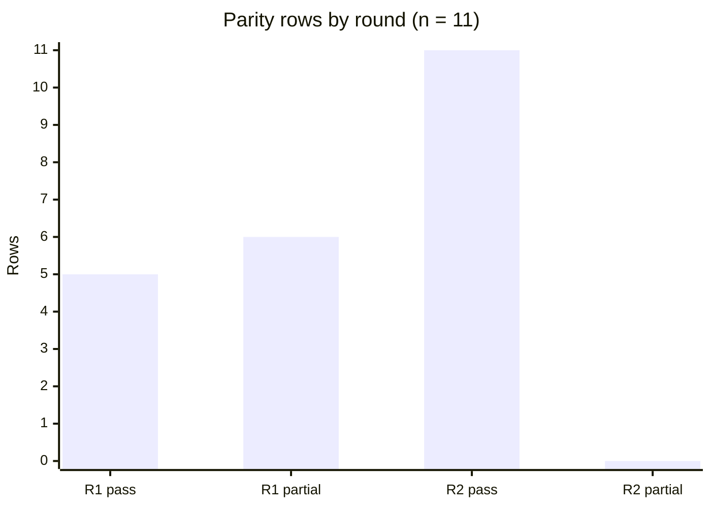

# Evaluation and Results

The evaluation asks whether the skill procedure produces a complete Docker replica of the owned appliance, and what an agent still lacks if it has the finished files but not the skills. Quality is the parity score. Speed is discussed only where this session actually observed extra work, and the scripted lookup times are not presented as model latency. Jimenez et al. (2024) score agents by the fraction of issues resolved. A second agent was not run, so there is no resolve rate and no agent task time.

## Quality after the procedure

The parity report dated 13 October 2026, read after the procedure had been applied, marks the replica built. The container is `raven`, the image is `raven-lab`, the Compose address is `172.30.10.10`, and the memory cap is `512m`. The unit of observation is one parity row. There are 11 rows. No row was missing in either round.

**Table 2.** Parity row counts before and after the skill rules were applied. Counts are readings of `replica-parity.md` on 13 October 2026. They are not a second agent's resolve rate.

| Round | Pass | Partial | Missing | Rows |
| --- | ---: | ---: | ---: | ---: |
| 1. Before the rules | 5 | 6 | 0 | 11 |
| 2. After the rules | 11 | 0 | 0 | 11 |
| Change | +6 | −6 | 0 | 0 |

*Figure 2. Same counts as Table 2. Round 1 is the replica before the skill rules. Round 2 is the replica after those rules were applied. The vertical axis is the number of parity rows.*

**Table 3.** Each parity row in round 1, the fix written into the procedure, and the round 2 score. Rows that were already pass have no fix.

| Area | Round 1 | Fix | Round 2 |
| --- | --- | --- | --- |
| Listening ports | Partial. rpc.statd absent | Install nfs-common and run rpc.statd -F after rpcbind | Pass. ssh 22, http 80, mysql 3306, sendmail 25 and 587, rpcbind 111, rpc.statd |
| Localhost-only services | Pass. 3306, 25, and 587 unpublished | None | Pass |
| Package versions | Partial. Debian 9 image and newer package strings | Rebuild FROM debian:jessie and pin the guest revisions | Pass. Guest version strings match |
| Users | Pass | None | Pass |
| Sudoers | Pass | None | Pass |
| Vhosts | Pass. *:80 raven.local, /var/www/html | None | Pass |
| Web paths | Pass. Homepage and /wordpress/ returned 200 | None | Pass |
| Databases | Partial. wordpress on MariaDB 10.1 | Install mysql-server 5.5.60 on a new volume | Pass. wordpress on MySQL 5.5.60, host localhost |
| Cron | Partial. php5 cron snippet missing | Keep the cron.d file from the distro php5 package | Pass. @reboot sendmail, plus php5 and sendmail |
| Mail | Partial. Sendmail 8.15; later 8.14 did not stay up under -bd | Pin 8.14.4, supervise sendmail -bD, score sockets after about 60 s | Pass. 127.0.0.1:25 and :587 |
| Application URL | Partial. Stored URL was the raw address | Keep http://raven.local/wordpress and map the name to 10.88.10.10 | Pass. That URL returns 200 |

**Table 4.** Package version strings named in the two readings of the parity report. Round 1 did not record a separate cron or sudo mismatch, so those cells are left blank rather than inferred. Round 2 strings are the strings the report says match the guest.

| Component | Guest, and round 2 | Round 1 replica |
| --- | --- | --- |
| Distribution | Debian 8.11 | Debian 9 |
| apache2 | 2.4.10-10+deb8u12 | 2.4.25 |
| php5 | 5.6.36+dfsg-0+deb8u1 | 5.6.40 |
| Database | MySQL 5.5.60-0+deb8u1 | MariaDB 10.1.48 |
| openssh-server | 1:6.7p1-5+deb8u4 | OpenSSH 7.4 |
| sendmail | 8.14.4-8+deb8u2 | 8.15.2 |
| cron | 3.0pl1-127+deb8u1 | |
| sudo | 1.8.10p3-1+deb8u5 | |

The gap list is still filled in, which is what the parity skill requires when the rows pass. Table 5 separates those gaps from the rows in Table 2. They are not counted as partial rows. Web and SSH are published on `10.88.10.10` ports 80 and 22 because a dedicated address was requested, and database and mail ports stay unpublished. The inventory and the parity report omit passwords, hashes, and flag values.

**Table 5.** Explicit gaps. These stay out of the pass column in both rounds. The version-substitution line is the only gap that the procedure closed.

| Gap | Round 1 | Round 2 |
| --- | --- | --- |
| Version substitution | MariaDB 10.1 in place of MySQL 5.5; Debian 9 packages in place of Debian 8 | None |
| Archive apt | Yes, with trusted=yes | Yes. snapshot.debian.org and archive.debian.org, trusted=yes |
| Second kernel | No. Container shares the host kernel | No. WSL kernel 6.18.40.1, guest kernel 3.16.0-6-amd64 |
| Init system | Supervisord in place of sysv init | Unchanged |
| Memory cap | 512 MB, equal to the guest | Unchanged |

This is the quality result of following the procedure. The image starts from Debian Jessie, pins the inventoried revisions, installs MySQL rather than MariaDB, keeps the guest application URL, publishes only web and SSH on the requested address, and runs Sendmail in the foreground. The package row is a pass because the version strings match, which is the packaging requirement in Nüst et al. (2020). The kernel line stays a gap because a container is operating-system virtualization, not a second guest (Boettiger, 2015; Felter et al., 2015).

## Quality before those rules were in the skills

Round 1 in Tables 2 through 5 is that earlier reading. The agent had produced a running container and a page that answered, and six of the eleven fidelity rows were still partial. Users, sudoers, virtual hosts, web paths, and unpublished localhost-only services were already pass. A container can look done on the checks an agent tries first, HTTP and a database schema, while the procedure's score is still partial. The skills tell the agent that those partials are the result, and what to change: the guest codename, `mysql-server` rather than MariaDB, the package that owns `rpc.statd`, the distro PHP cron snippet, the stored URL left intact, and `dpkg-query` before a pass mark.

Sendmail shows the same split between a local experiment and a rule. Before the skill stated the foreground flag, exploratory invocations used `sendmail -bd` and waits of a few seconds. The parent forks, so supervisor records the program stopped, and the listeners are not up yet because this Sendmail sleeps about a minute after its startup DNS and syslog attempt. Shortening resolver timeouts and providing `/dev/log` did not remove that sleep. The build skill now says to supervise `sendmail -bD`, to keep `startsecs` short, and to score ports 25 and 587 from `ss` after the minute. The parity skill repeats that supervisor status is the wrong signal. After that change, the report marks mail pass and supervisor shows the program running.

## What the next agent inherits

The with-skills agent inherits the six-step order and the stop conditions. It is told not to import onto a missing NAT network, not to edit a running disk, not to trust a current apt mirror, not to publish a loopback-only service, not to treat MariaDB as MySQL, not to score mail from supervisor during the startup minute, and not to mark the shared kernel as a pass. It is also told how to verify: `dpkg-query`, `ss`, the application URL, and the gap list.

The without-skills agent inherits the finished settings if it can see the files. The Dockerfile names six snapshot timestamps and pins the guest revisions, including MySQL 5.5.60 and Sendmail 8.14.4. Compose publishes `10.88.10.10:80` and `10.88.10.10:22` only. The PHP configuration points at `/var/run/mysqld/mysqld.sock`. Supervisord runs `/usr/sbin/sendmail -bD -q15m`. Those are the outcomes. They do not say when `trusted=yes` is legal, why the socket path matters, why `-bd` fails under supervisor, or why the kernel row must not be added.

A scripted search on 13 October 2026 makes that split countable. The script already knew the 23 sentences. It is a text lookup, not an agent converting an OVA.

**Table 6.** Exact-string hits for 23 coded rule sentences. Each condition was repeated five times. The one replica-file hit is the apt assignment that disables `Check-Valid-Until`.

| Corpus | Files read | Sentences found | Sentences coded | Hit rate |
| --- | ---: | ---: | ---: | ---: |
| Three skills | 3 | 23 | 23 | 23/23 |
| Replica files | 8 | 1 | 23 | 1/23 |

**Table 7.** Wall-clock time of that script, in milliseconds, measured with `System.Diagnostics.Stopwatch` in one PowerShell process. Repetition 1 is the cold read. The median is the third value after sorting. These times are not language-model task times.

| Repetition | Skills (ms) | Replica files (ms) |
| --- | ---: | ---: |
| 1 | 13.962 | 177.144 |
| 2 | 1.389 | 147.352 |
| 3 | 1.014 | 143.469 |
| 4 | 0.971 | 132.805 |
| 5 | 0.998 | 134.365 |
| Median | 1.014 | 143.469 |

The medians show that a known sentence is cheap to find once, and that 22 of the 23 sentences are not in the replica files at all. They do not measure how long a language model takes to apply the procedure or to rediscover it on a guest.

The speed claim that the session does support is about avoided iteration, and it is qualitative. The early path spent rebuilds on the wrong suite and the wrong database engine, and it spent short Sendmail probes that could not observe the listener. The skills now state the correct base, the correct engine, the correct flag, and the correct wait before the next agent starts. That removes those iterations from the next conversion. It does not, by itself, produce a measured agent speedup, because the second conversion was not timed.

## How to read the result

Tables 2 through 5 are quoted from the two readings of `replica-parity.md`. Blank cells in Table 4 were not reported in round 1 and are not filled in. Tables 6 and 7 are measured script results. None of these is an agent task time or a resolve rate. The result that matters for the conversion is Table 2: six partial fidelity rows become passes, and Table 5 leaves archive apt, the shared kernel, and supervisord as gaps the procedure refuses to hide.

Sources cited in this section are listed in Related-Work.md.
