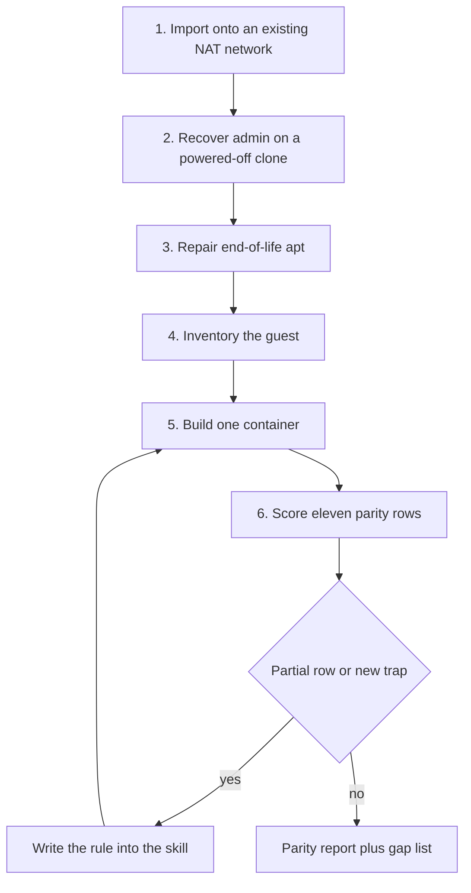

# Methodology

## The agent procedure

The method is the order in which a language-model agent reads and applies six skills. The skills are generic. The appliance supplies the facts. The agent does not invent a new conversion plan for each OVA.

1. `importing-ova-nat-network`. Register one appliance in VirtualBox and attach only that virtual machine's enabled adapters to a NAT network that already exists. Record the virtual-machine list before and after. Stop if the NAT network is missing, if the chosen name collides, or if any other virtual machine changes.

2. `recovering-linux-admin-offline`. Use this only when the guest password is unknown and the machine is powered off. Clone the disk, edit local accounts on the clone, and verify login. Stop rather than switching to an online attack. The operator's password is chosen at runtime and is not written into the skill or the inventory.

3. `repairing-eol-apt-archives`. Run this when `apt-get update` fails because the suite has left the active mirrors. Keep the suite names, point them at the archive or a dated snapshot, and disable `Acquire::Check-Valid-Until`. Add `trusted=yes` only on archived lines that still fail with `EXPKEYSIG`, an expired signature, or `NO_PUBKEY`. Do not add it to a mirror that is still current. Stop if `apt-get update` already exits 0. Verification is `apt-get update` and a simulated install of bash, both exiting 0. Archive mirrors remain an explicit parity gap.

4. `inventorying-linux-vm`. Record listeners, human users, sudoers, service package versions, web roots and the application URL, the application database name, user, and host, cron, and mail. Replace passwords, hashes, and flag values with a redaction token.

5. `building-docker-vm-replica`. Build one container when the database host is local. Start from the guest's Debian or Ubuntu codename and install the inventory's database package, not a substitute engine. Publish only the web and SSH ports the guest exposed. Leave database, mail, and other loopback services unpublished. When the operator asks for a dedicated local address instead of localhost, publish those same port numbers only on that address, and map the guest hostname to it rather than rewriting the stored application URL. Initialize the application database once. Read its password from the configuration file as text. Point the application runtime at the database socket the server creates. Supervise long-running processes in the foreground, including `sendmail -bD` rather than `sendmail -bd`. If the archive no longer has an inventoried revision, pin the snapshot timestamp that still does, and do not call the package row a pass until `dpkg-query` matches.

6. `evaluating-docker-vm-parity`. Score the eleven rows from the inventory and from live commands, not from the Dockerfile alone. If the replica is not running, score the runtime rows missing. Score mail from listening sockets after Sendmail's startup delay of about a minute, not from supervisor status in the first seconds. A requested dedicated address on the guest port numbers is a pass for those published ports. Archive apt alone does not make matching version strings partial. The host kernel, the supervisor, and archive apt stay in the gap list. The report must not contain exploit steps, secrets, hashes, or flag values. If a check would require attacking a service, record the version and stop.

*Figure 1. Order in which the language-model agent applies the skills. Step 2 runs only when the guest password is unknown. A trap discovered during scoring is written back into the skill before the replica is treated as finished.*

**Table 1.** Contract of each skill: the fact that lets the agent stop, and the check that counts as verification.

| Step | Skill | Stop condition | Verification |
| --- | --- | --- | --- |
| 1 | importing-ova-nat-network | NAT network missing, name collision, or another virtual machine changed | Virtual-machine list before and after |
| 2 | recovering-linux-admin-offline | Password already known, or the next step would be an online attack | Login on the clone |
| 3 | repairing-eol-apt-archives | `apt-get update` already exits 0, or the mirror is still current | `apt-get update` and a simulated install of bash both exit 0 |
| 4 | inventorying-linux-vm | A secret, hash, or flag value would be written down | Listeners, accounts, packages, URL, database, cron, and mail, with secrets redacted |
| 5 | building-docker-vm-replica | Database host is not local, or a loopback-only service was published | Image present, container running, `docker inspect` of memory, address, and port bindings |
| 6 | evaluating-docker-vm-parity | Inventory missing, replica status unknown, or the check would require an attack | Eleven rows scored pass, partial, or missing, with the gap list filled in |

That order is the with-skills condition. The agent opens the skill that matches the current precondition, copies its progress list, runs the named commands, and stops where the skill says to stop. When a conversion reveals a trap that the skill did not yet state, the agent updates the skill. On this appliance those additions included exact snapshot pins, the PHP socket path, the rule against reading the database password through a PHP include, the dedicated-address publish rule, and the Sendmail foreground flag plus the one-minute scoring delay.

The without-skills condition is the same agent with the guest, the chat, and the finished files, and without those documents. It can see a setting that was chosen. It does not inherit the precondition that made the setting legal, and it does not inherit the checks that would reject a confident substitution. Guerriero et al. (2019) report that practitioners already lack tests for infrastructure code. The parity skill is the test the next agent is supposed to run.

## How the result is judged

Quality is the parity report. A row passes only when the listener, account, rule, path, schema, schedule, or package version string matches and the practical result matches. The application URL must answer. Substitutions stay partial until they are gone. The three structural gaps stay gaps. Secrets stay out of the report. This is the project analogue of the resolve check in Jimenez et al. (2024): the narrative of the build is not the score.

Speed is treated more narrowly, because a second agent was not run and the replica was not rebuilt for this paper. Two observations are reported, and they are not the same kind of number. The first is qualitative and comes from the conversion itself. Before the corresponding rules were in the skills, the agent produced a Debian 9 and MariaDB replica, rewrote the application URL toward a raw address, omitted `rpc.statd` and the php5 cron snippet, and probed Sendmail with the forking flag and with waits of a few seconds. Those are extra iterations. After the rules were written down, the procedure tells the next agent the base image, the package pins, the publish address, the foreground Sendmail flag, and the one-minute observation window, so those iterations are not part of the next conversion. No model latency was measured for that contrast. The second observation is a scripted lookup, included only to show where the rules reside. It is not an agent speed.

## Where the rules reside

On 13 October 2026 a PowerShell script timed exact lookup of 23 rule sentences drawn from the parity, apt, and build skills. The counts and times are reported as Tables 6 and 7. The with-condition read those three skill files. The without-condition searched the same sentences in the replica files that record the finished settings (`Dockerfile`, Compose, entrypoint, MySQL and PHP configuration, supervisord, inventory, and the parity report), excluding `.git` and the imported guest tree. Each condition was repeated five times with `System.Diagnostics.Stopwatch`. The times are wall-clock milliseconds of that script. They measure text lookup by a program that already knows the sentence. They do not measure how long a language model takes to apply the procedure or to rediscover it on a guest.

The study did not run `docker exec` again while writing this paper. Where a pass or a version string is quoted, the source is the parity report or the image definition as read. Hummer et al. (2013) and Shambaugh et al. (2016) are the background claim that a declared configuration still needs an independent check. The check this paper relies on for the replica is the parity report produced by the procedure. The check it adds is whether the decision rules are in the skills the next agent will read.

Sources cited in this section are listed in Related-Work.md.
